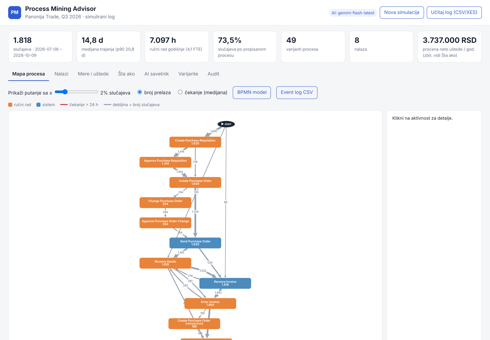
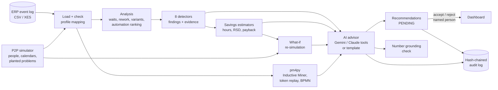
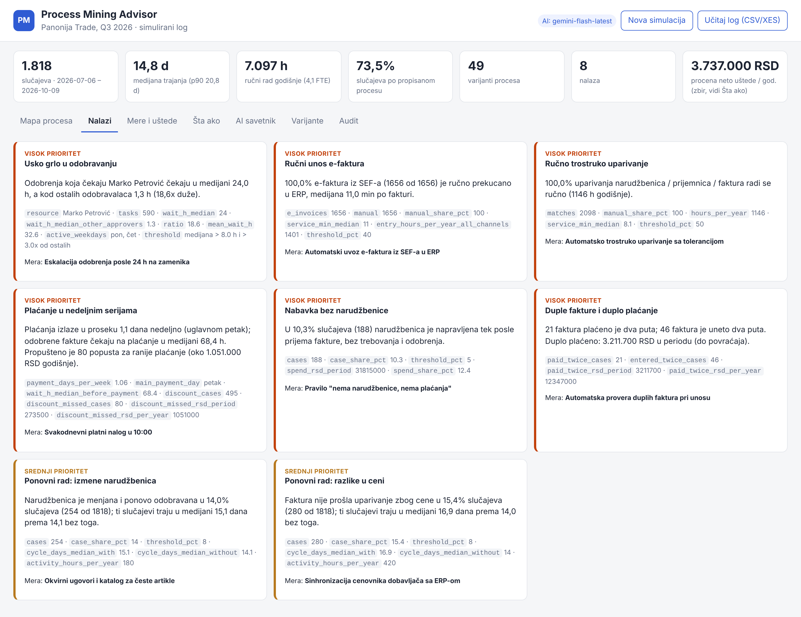
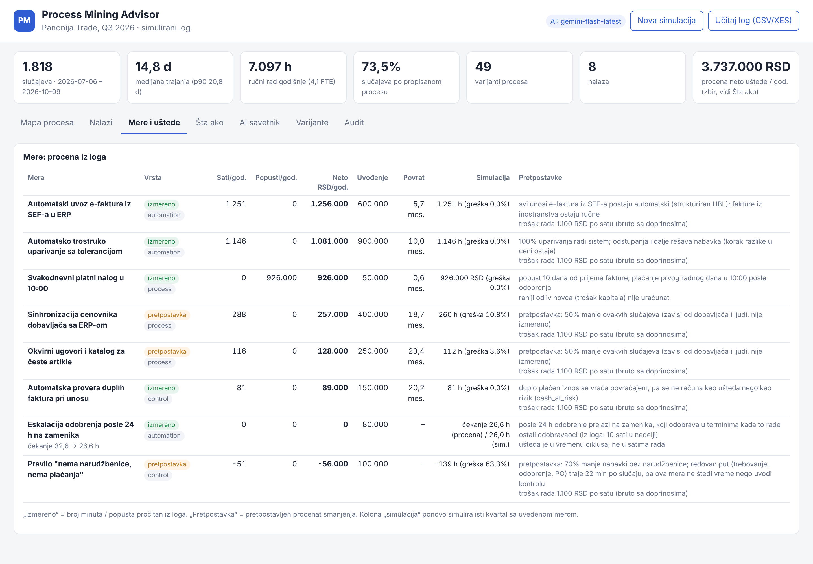
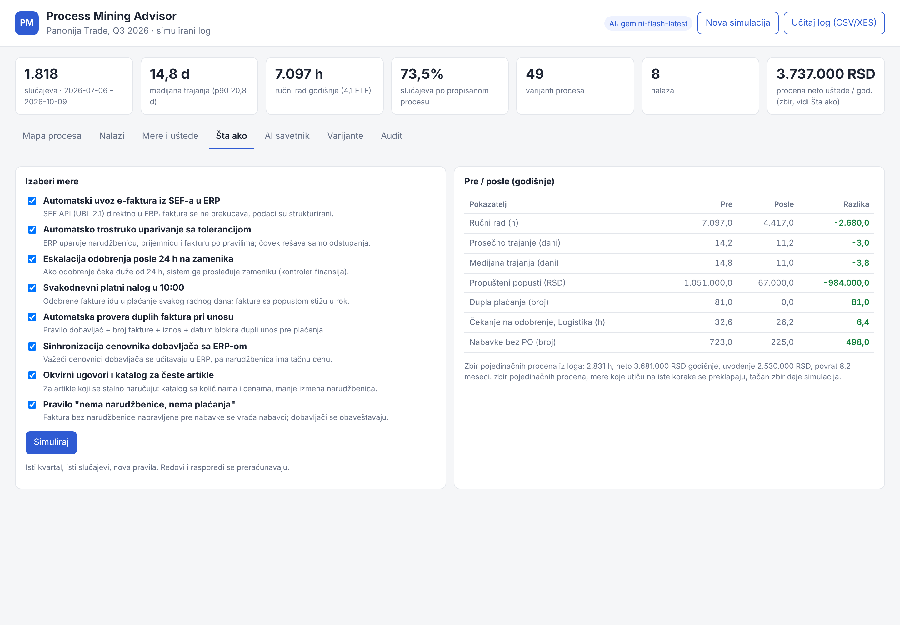
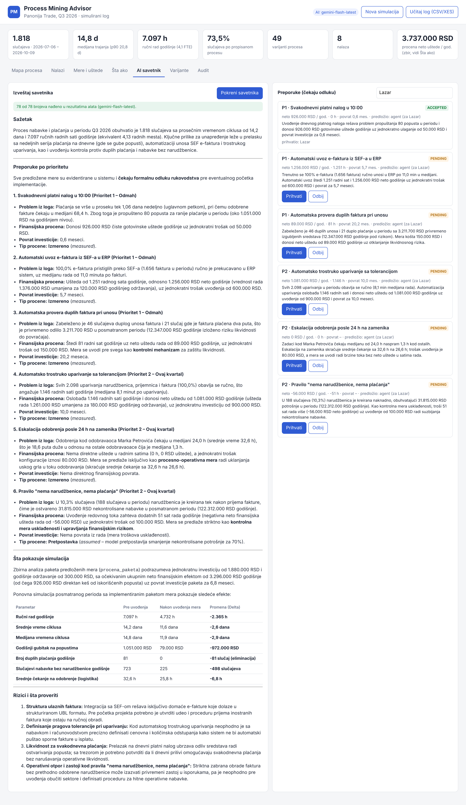

# Process Mining Advisor: find what to automate in purchase-to-pay, and what it would save

A process-mining tool for the purchase-to-pay process (requisition → purchase order → goods receipt → invoice →
payment). It reads an ERP event log, rebuilds how the process actually runs (**pm4py**: discovery, conformance
checking, BPMN), finds bottlenecks, rework and rule breaks, estimates the savings of concrete automation measures
from the log, checks those estimates by re-simulating the quarter with the measure applied, and lets an **AI
advisor** (Gemini or Claude) write a prioritised recommendation report in Serbian. A person accepts or rejects every
recommendation, every number in the AI report is checked against the tool results, and every step goes to a
tamper-evident audit log.



## Why this problem

Mid-size companies in Serbia run purchasing and payables on an ERP plus a lot of manual work: SEF e-invoices typed
into the ERP by hand, invoices matched to orders and goods receipts by hand, approvals that wait for one manager,
payments that go out once a week and lose early-payment discounts. Everyone feels it, nobody can say how big it is.
The ERP already records every step with a timestamp. Process mining turns that record into numbers, and the numbers
into a business case.

## What it does

| Step | How | Who decides |
|---|---|---|
| Load the log | CSV or XES, column mapping, data checks (missing timestamps, no start times, no resources) | system |
| Discover the process | directly-follows map with frequencies and waiting times; Inductive Miner model, BPMN export | pm4py |
| Check conformance | token-based replay against the to-be process; deviation patterns ("PO created after the invoice") | pm4py |
| Find problems | 8 rule-based detectors, each with a written threshold and the numbers behind it | rules |
| Estimate savings | per measure, from the log: hours, RSD, implementation cost, payback; `measured` vs `assumed` | estimators |
| What-if | re-simulate the same quarter with the measures applied (queues, approval windows, payment runs) | simulator |
| Recommend | AI advisor (Gemini / Claude tool use) or a template advisor without a key; recommendations are PENDING | LLM / rules |
| Check the AI text | every number in the report must appear in a tool result; the rest is highlighted | system |
| Decide | only a named person can accept or reject; agents are refused | **person** |
| Audit | SHA-256 hash chain over every event | system |

## Architecture



Design decisions and the reasons behind them: [DECISIONS.md](DECISIONS.md).

## Results

All numbers are on **synthetic** logs from the built-in simulator. Full report: [docs/eval_report.md](docs/eval_report.md)
(`pma eval --llm`).

| Detection of 8 planted problems (40 scenarios per log type) | Precision | Recall |
|---|---|---|
| Clear problems | 100% | 100% |
| Mild problems, close to the thresholds | 100% | 77.5% |
| Noisy logs (5% of events missing, ±30 min timestamp jitter) | 100% | 100% |
| Logs without start timestamps | 100% | 100% |

| Savings estimate from the log vs re-simulation with the measure applied (20 scenarios) | Mean abs. error |
|---|---|
| SEF→ERP integration, automatic matching, duplicate check (manual hours) | 0.0-0.5% |
| Daily payment run (early-payment discounts captured) | 0.0% |
| Approval escalation (waiting time), calendar-aware estimate | 1.8% (first naive version: ~40%) |
| Process measures with an assumed reduction (price catalog, framework contracts) | 5-7% |
| "No PO, no pay" policy | 59% (a control measure: it adds work, and the estimate understates how much) |

| AI advisor, Gemini `gemini-3.5-flash`, 3 scenarios (small sample, free-tier quota) | Result |
|---|---|
| Planted problems with a matching recommendation | 15 of 15 |
| Recommendations for problems that were not planted | 0 |
| Numbers in the reports found in tool results | 183 of 183 |
| Time per report | ~71 s, ~6 model calls |

Demo company (Panonija Trade, one simulated quarter, 1,818 purchases): about 7,100 manual hours a year (4.1 FTE).
The biggest measures: SEF→ERP integration (1,251 h, net ~1.26 million RSD a year, payback ~6 months), automatic
three-way matching (1,146 h, ~1.08 million RSD), daily payment run (~926,000 RSD of early-payment discounts).
Simulated together with approval escalation, duplicate check and price catalog sync: manual work 7,097 → 4,431 h a
year, mean purchase-to-pay time 14.2 → 10.8 days, missed discounts 1,051,000 → 67,000 RSD a year.

Why the "measured" errors are so small: for mechanical measures the estimate removes exactly the minutes that the
simulator removes, so agreement is expected by construction. The check earns its keep where queues and calendars
interact: the first approval-escalation estimate was off by about 40% until it used the approvers' real working
hours from the log.

| Findings | Levers and savings | What-if | AI advisor |
|---|---|---|---|
|  |  |  |  |

## Quick start

```bash
pip install -e ".[dev]"
pma analyze                              # demo company: KPIs, conformance, findings, savings
pma whatif --levers sef_erp_integration,daily_payment_run
pma serve                                # dashboard at http://127.0.0.1:8000
pma eval                                 # evaluation report -> docs/eval_report.md
```

AI advisor: set a free Gemini key (Google AI Studio) or an Anthropic key. Without a key the template advisor is used.

```bash
export GEMINI_API_KEY=...                # or ANTHROPIC_API_KEY=...; LLM_PROVIDER=gemini|anthropic to choose
pma advise
pma eval --llm                           # also evaluates the AI advisor
```

Your own log: a CSV with `case_id, activity, complete` (and ideally `start`, `resource`, `amount_rsd`,
`invoice_channel`, `discount_pct`), then `pma analyze --log my_log.csv --profile my_profile.json`, where the profile
maps your activity names (see `pmadvisor/profile.py`). `pma simulate --out log.csv` writes a sample log in this format.

Docker: `cp .env.example .env && docker compose up --build`, then open http://localhost:8000.

## Project layout

```
pmadvisor/
  simulate.py     discrete-event P2P simulator (people, working hours, approval windows, payment runs)
  scenario.py     the 8 plantable problems and the fictional demo company
  eventlog.py     CSV/XES loading, column mapping, data checks
  profile.py      activity/attribute mapping and the to-be process
  analysis.py     KPIs, waits, DFG, variants, rework, resources, automation ranking
  discovery.py    pm4py: Inductive Miner, token-based replay, deviation patterns, BPMN export
  findings.py     8 detectors with thresholds and evidence
  levers.py       automation measures, savings estimators, implementation cost assumptions
  whatif.py       re-simulation with measures applied, estimate vs simulation
  advisor/        tools, Gemini / Claude tool loop, template advisor, number grounding check
  service.py      workspace, human-in-the-loop rules
  store.py        SQLite: runs, recommendations, reports, LLM calls, hash-chained audit
  api.py, cli.py  FastAPI + `pma` command
  eval/           evaluation runner
web/              dashboard (plain JS, Cytoscape.js + dagre, vendored)
tests/            34 tests, including both LLM loops with scripted fake models
```

## Limitations and next steps

- Synthetic data. The simulator and the detectors were written by the same builder, so detection on clear problems
  shows that the logic works, not that it generalises. Next test: the public BPI Challenge 2019 P2P log.
- What-if works only for simulated logs. For a real company it needs a simulation model calibrated on its log
  (arrival rates, effort per step, calendars from the data).
- Implementation costs and the hourly cost (1,100 RSD) are rough assumptions; process measures use assumed
  reduction rates, marked as such.
- pm4py is AGPL-3.0; a closed-source product needs its commercial license or another discovery module.
- Demo authentication is a name in a header; production needs SSO and roles.

## Role

Lazar Mihajlović: project owner (problem, scope, goals). Built with AI assistance (Claude as the builder, which also
proposed the design; Lazar accepted it). See [DECISIONS.md](DECISIONS.md) and the interview guide
[docs/VODIC_ZA_INTERVJU.md](docs/VODIC_ZA_INTERVJU.md).

Code: MIT (see LICENSE). Dependencies keep their own licenses (pm4py: AGPL-3.0).
